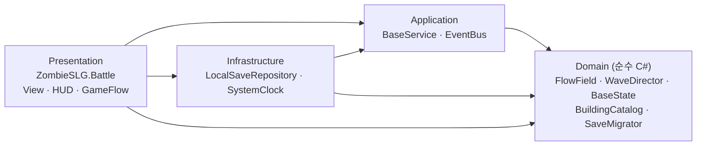

# 좀비 생존 SLG (가제)

> 무너진 한국 도시에서 낮에는 피난처를 키우고, 밤에는 몰려오는 감염체를 직접 막아내는 생존 전략 게임.

Unity 6 · URP · 모바일 세로 화면 · 1인 개발

<!-- 플레이 영상 / 스크린샷: docs/media/ 에 넣고 여기에 링크 -->


---

## 지금 되는 것

| 단계 | 내용 | 상태 |
|---|---|---|
| **M0 전투 프로토타입** | 3분 밤 습격 · 좀비 3종 · 플로우 필드 길찾기 · 영웅 1명 + 화염 폭격 · 기관총 포탑 · 타격감(히트 스톱, 화면 흔들림, 데미지 숫자, 파편) | ✅ |
| **M1 기지 경영 루프** | 건물 7종 · 생산/창고 상한/식량 소비/사기 · 생존자 배치 · 건설 대기열 · 오프라인 정산 · 암호화 로컬 세이브 · 낮↔밤 루프 | ✅ |
| M2 영웅·병력·가챠 | 데이터 파이프라인 · 영웅 8명(등급 4·역할 3·조각 승급·배치 3자리) · 모집(천장·10회 확정·확률 공개) · 병종 3(상성·문별 배치·부상병 치료) · 연구 13개(경제·군사·방어) | ✅ |
| M3 서버 연동 | UGS 인증 · Cloud Save · Cloud Code 서버 시간 타이머 | ⏳ |
| M4 최적화·폴리싱 | Jobs/Burst + GPU 인스턴싱, Addressables, 튜토리얼 | ⏳ |
| M5 출시 | IAP·광고 테스트 연동, 구글 플레이 출시 | ⏳ |

## 실행

1. Unity **6000.0.84f1** 로 프로젝트 열기
2. 메뉴 **ZombieSLG ▸ 0. 전체 설정** (3D URP 렌더러 + 씬 생성, 최초 1회)
3. Game 뷰를 1080×1920 등 세로 해상도로 두고 **Play**

| 조작 | |
|---|---|
| 낮: 건물 탭 | 건설 / 업그레이드 / 인력 배치 · 병영(훈련) · 진료소(치료) · 연구소(연구) |
| 밤: 땅 탭·드래그 | 영웅 이동 (사격은 자동) |
| Q / 버튼 → 땅 탭 | 화염 폭격 |
| T | 좀비 200마리 스트레스 테스트 (FPS 표시) |

에디터 메뉴: `ZombieSLG ▸ 진행 데이터 초기화` · `세이브 폴더 열기`

## 아키텍처

게임 규칙은 Unity에 의존하지 않는 순수 C#에 두고, 의존성은 모두 안쪽(Domain)을 향합니다. 어셈블리 정의(asmdef)로 컴파일 단계에서 강제합니다.



| 어셈블리 | UnityEngine 참조 | 내용 |
|---|---|---|
| `ZombieSLG.Domain` | ❌ | 길찾기, 웨이브, 전투 공식, 기지 경제, 세이브 모델·마이그레이션 |
| `ZombieSLG.Application` | ❌ | 유스케이스(BaseService), 이벤트 버스, 시계·저장소 인터페이스 |
| `ZombieSLG.Infrastructure` | ✅ | AES 암호화 JSON 세이브(원자적 쓰기 + 백업), 시스템 시계 |
| `ZombieSLG.Battle` | ✅ | 맵·좀비·영웅·포탑·HUD·낮밤 상태 머신 |
| `ZombieSLG.Tests.EditMode` | — | Domain/Application 단위 테스트 |

### 기술 포인트

- **플로우 필드** — 목표(본부)가 하나라서 Dijkstra 한 번으로 모든 좀비가 같은 방향장을 공유합니다. 대각선 모서리 통과 금지, 도달 불가 셀 처리.
- **대량 유닛** — M0 기준선은 GameObject + 풀링 + 공간 해시(이웃 탐색 O(n)). M4에서 Jobs/Burst + GPU 인스턴싱으로 바꾸고 전후 프로파일을 비교합니다.
- **결정적 웨이브** — 시드 기반 `WaveDirector`. 같은 밤은 항상 같은 스폰 → 재현·테스트·서버 검증이 가능합니다.
- **오프라인 정산** — 건설 완료 시점에서 시간 구간을 나눠 정산합니다. "한 번에 2시간 점프"와 "1초씩 7200번"의 결과가 같은지 테스트로 보장합니다.
- **데이터 드리븐** — 수치 100% CSV(`Data/Tables`). 저장하면 에디터 임포터가 검증 후 ScriptableObject로 가져오고, 오류는 `파일:줄 [열]`로 표시합니다. 규칙 객체(`GameData`)를 주입받는 구조라 테스트·서버·Remote Config가 같은 규칙을 씁니다. → [docs/DATA_TABLES.md](docs/DATA_TABLES.md)
- **모집(가챠)** — 시드 + 모집 횟수로 결정되는 결과라 서버가 재계산해 검증할 수 있습니다(M3). 천장·10회 확정·확률은 테스트에서 수만 회 시뮬레이션으로 확인하고, 영웅별 확률 공개 화면은 표에서 자동 계산됩니다.
- **병력 전투** — 분대 규칙(`SquadState`)은 도메인에 있습니다. 앞줄(보병→장갑차→사수)부터 피해를 받고, 쓰러진 병사는 부상/전사 비율을 누적값으로 나눠 매번 같은 결과가 나옵니다. 좀비는 가장 가까운 방어자(영웅·분대)를 공격합니다.
- **완료 이벤트 순서 정산** — 건설·연구·훈련·치료 완료를 시간순으로 나눠 정산하므로 연구 효과가 오프라인 중에도 정확한 시점부터 적용됩니다(점프=1초씩 테스트).
- **세이브 버전 관리** — `GameSave.Version`(현재 v3) + `SaveMigrator`. 새 건물·병력·연구가 추가돼도 기존 세이브가 자동 변환됩니다.

## 테스트

```powershell
dotnet test tools/DomainTests      # Unity 없이 게임 규칙 테스트 (CI와 동일)
```

Unity: `Window ▸ General ▸ Test Runner ▸ EditMode ▸ Run All`

## 폴더

```
Assets/_Project/
  Scripts/
    Domain/          순수 C# 게임 규칙 (Data/: CSV 파서·GameData 빌더)
    Application/     유스케이스, 이벤트 버스
    Infrastructure/  세이브, 시계
    Battle/          프레젠테이션 (전투 + 기지)
    Editor/          설정 메뉴
  Data/Tables/       밸런스 CSV (zombies · buildings · hordes · heroes · troops · research · balance)
  Resources/         GameData.asset (CSV에서 자동 생성)
  Tests/EditMode/    단위 테스트
tools/DomainTests/   .NET 테스트 프로젝트 (CI용)
docs/                작업 가이드, 개발기
```

## 작업 방식

브랜치·커밋 규칙, CI, 마일스톤 관리: [docs/GIT_WORKFLOW.md](docs/GIT_WORKFLOW.md)
